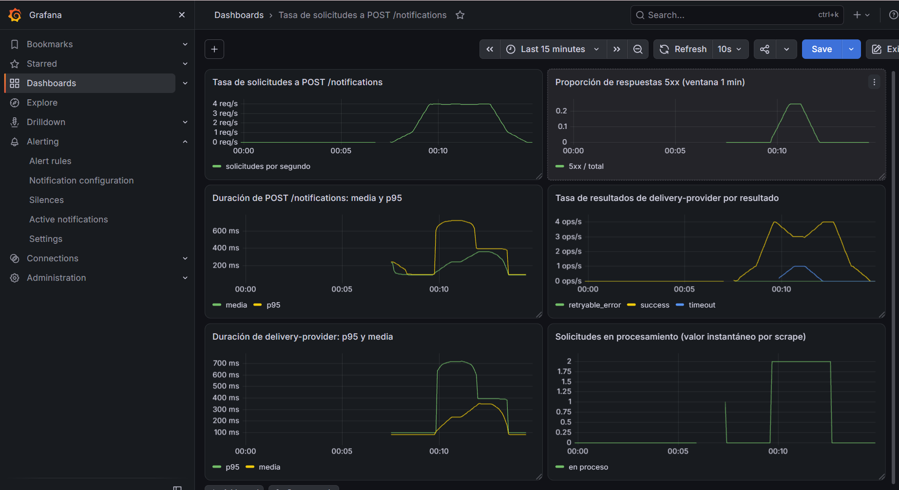
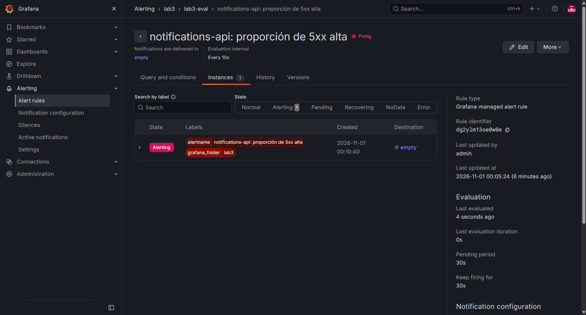

# Laboratorio 3. Instrumentación y observación de un servicio

## 1. Diseño de instrumentación

Complete la tabla antes de describir la implementación final.

| Pregunta operacional | Señal | Evidencia necesaria | Decisión de instrumentación |
|---|---|---|---|
| ¿Cómo cambia la actividad de `notifications-api`? | La Tasa de solicitudes recibidas por segundo. | Se usa un conteo por cada solicitud completada a `POST /notifications`, con método y ruta para separarla de `/health` y `/metrics`. | Que el Counter `notifications_http_requests_total`, vaya incrementado una vez al terminar cada solicitud (en el `finally` de `createNotification`). Labels `method`, `route`  `/notifications`) y `status_code`. La tasa se obtiene con `rate()`. |
| ¿Qué proporción de solicitudes termina con error? | La proporción de respuestas 5xx sobre el total en una ventana reciente. | Tener el código HTTP final de cada solicitud. Categorías: 202 (enviada), 400 (inválida), 502 (error del proveedor o inalcanzable), 504 (timeout del proveedor). | El mismo Counter, con label `status_code` igual al código enviado al cliente. Proporción = tasa de `status_code` 5xx / tasa total. |
| ¿Cómo evoluciona la duración de `POST /notifications`? | Distribución de duraciones (media y p95). | Una duración en segundos por solicitud, medida desde que entra al handler hasta que se responde, incluyendo llamadas al proveedor, reintentos y la espera de 50 ms entre intentos. | Histogram `notifications_http_request_duration_seconds` con `startTimer()` al inicio y `end()` en el `finally`. Labels `method`, `route`, `status_code`. Buckets `[0.05, 0.1, 0.15, 0.25, 0.3, 0.4, 0.5, 0.6, 0.75, 1, 2]`, que separan normal (~0.08 s), reintento (~0.21 s), slow (~0.35 s) y timeout (~0.7 s). |
| ¿Qué resultados produce `delivery-provider`? | Tasa de resultados por categoría. | Resultado de cada operación del proveedor: `success` (202), `timeout` (504), `retryable_error` (503), más `invalid_request` (400). Canal (`email`/`sms`) para comparar. | Counter `delivery_requests_total`, incrementado en cada rama de `deliverNotification`, incluidas las que hacen `return` temprano. Labels `result` y `channel`. |
| ¿Cómo evoluciona la duración de la dependencia? | Distribución de duraciones del proveedor. | La duración en segundos de cada operación del proveedor, desde que recibe `POST /deliver` hasta que responde, separada por resultado. | Histogram `delivery_request_duration_seconds` con timer al entrar al handler y `end({ result })` en cada rama. Label `result`. Buckets `[0.025, 0.05, 0.1, 0.2, 0.3, 0.4, 0.5, 0.6, 0.75, 1]`, que separan 80 ms, 350 ms y 700 ms. |
| ¿Qué ocurrió durante una solicitud concreta? | Secuencia de eventos correlacionados entre ambos servicios. | Eventos con nombre estable, timestamp y nivel; `request_id` para correlacionar entre servicios; `notification_id` para identificar la entidad; `channel`, `template`, `attempt`, código de respuesta, resultado y duración. Sin `recipient` ni `message`. | Eventos JSON con Pino usando `req.log`, que ya incluye `request_id` gracias a `logging.ts`. En notifications-api: `notification.received`, `delivery.attempt.started`, `delivery.attempt.retryable_failure` (WARN), `notification.delivered` (INFO), `notification.failed` (ERROR), `notification.unexpected_error` (ERROR). En delivery-provider: `delivery.received`, `delivery.succeeded` (INFO), `delivery.retryable_error` (WARN), `delivery.timeout` (ERROR). |

## 2. Logging estructurado

### 2.1 Eventos y contexto

Documente los eventos estructurados diseñados para cada servicio. Para cada categoría relevante indique el nivel utilizado y los campos de contexto que conserva.

| Servicio | Evento | Nivel | Campos relevantes | Justificación |
|---|---|---|---|---|
| notifications-api | `notification.received` | INFO | request_id, notification_id, channel, template | Marca el inicio de una operación válida y permite saber qué entidad y tipo de notificación se procesó. |
| notifications-api | `notification.rejected` | WARN | request_id, reason | La solicitud inválida del cliente, no se registran los valores recibidos. |
| notifications-api | `delivery.attempt.started` | INFO | request_id, notification_id, channel, attempt, dependency | Indica cuándo se invoca al proveedor y en qué intento permite medir el tiempo entre intentos. |
| notifications-api | `delivery.attempt.retryable_failure` | WARN | request_id, notification_id, attempt, dependency, dependency_status, result, will_retry | es una condición rara pero recuperable: la operación todavía puede terminar bien. |
| notifications-api | `notification.delivered` | INFO | request_id, notification_id, channel, attempt, status_code, result, duration_ms, dependency_duration_ms | Resultado final exitoso con duración total y en la dependencia. |
| notifications-api | `notification.failed` | ERROR | request_id, notification_id, channel, attempt, dependency_status, status_code, result, duration_ms | Es el fallo que determina el resultado final (timeout o error del proveedor). |
| notifications-api | `notification.unexpected_error` | ERROR | request_id, notification_id, dependency, status_code, error.type, error.message | Excepción no prevista (p. ej. proveedor inalcanzable); solo tipo y mensaje del error. |
| delivery-provider | `delivery.received` | INFO | request_id, notification_id, channel, attempt | Este confirma que la dependencia recibió la solicitud y qué numrtp de intento era. |
| delivery-provider | `delivery.succeeded` | INFO | request_id, notification_id, channel, attempt, status_code, result, duration_ms | Entrega aceptada (202). |
| delivery-provider | `delivery.retryable_error` | WARN | request_id, notification_id, channel, attempt, status_code, result, duration_ms | 503 recuperable: el cliente puede reintentar. |
| delivery-provider | `delivery.timeout` | ERROR | request_id, notification_id, channel, attempt, status_code, result, duration_ms | 504 tras ~700 ms; provoca el fallo final de la operación. |
| delivery-provider | `delivery.rejected` | WARN | request_id, result, status_code | Solicitud inválida recibida por el proveedor. |

Explique brevemente la diferencia entre el uso de `request_id` y `notification_id` en su solución.

`request_id` identifica una **solicitud técnica concreta**: lo genera o recibe notifications-api, se propaga mediante `X-Request-ID` y aparece igual en ambos servicios, por lo que permite reconstruir una ejecución distribuida (incluidos todos sus intentos). `notification_id` identifica la **entidad de dominio** (la notificación); se usa para saber qué notificación fue afectada, pero no distingue dos solicitudes técnicas distintas sobre la misma notificación (por ejemplo, si el cliente la reenviara).

### 2.2 Reintento recuperable

Ejecute:

```bash
npm run probe:retry
```

Utilice `jq` para localizar `request_id=req-retry-01` en **ambos servicios**. Incluya las consultas utilizadas y reconstruya la secuencia observada. Explique por qué los niveles asignados son coherentes con el resultado final de la operación.

**Consultas utilizadas:**

```bash
jq 'select(.request_id == "req-retry-01")' logs/notifications-api.jsonl
jq 'select(.request_id == "req-retry-01")' logs/delivery-provider.jsonl

# Ambos servicios juntos, solo los campos relevantes, ordenados por timestamp:
jq -c 'select(.request_id == "req-retry-01") | {time, level, event, attempt, status_code, dependency_status, result}' \
  logs/notifications-api.jsonl logs/delivery-provider.jsonl | jq -s -c 'sort_by(.time)[]'
```

**Eventos relevantes encontrados** (ejecución del 2026-10-31 a las 22:11:23 hora local; `time` en ms epoch; niveles Pino: 30 = INFO, 40 = WARN):

```json
{"time":1793506283203,"level":30,"event":"notification.received","attempt":null,"status_code":null,"dependency_status":null,"result":null}
{"time":1793506283203,"level":30,"event":"delivery.attempt.started","attempt":1,"status_code":null,"dependency_status":null,"result":null}
{"time":1793506283205,"level":30,"event":"delivery.received","attempt":1,"status_code":null,"dependency_status":null,"result":null}
{"time":1793506283286,"level":40,"event":"delivery.retryable_error","attempt":1,"status_code":503,"dependency_status":null,"result":"retryable_error"}
{"time":1793506283290,"level":40,"event":"delivery.attempt.retryable_failure","attempt":1,"status_code":null,"dependency_status":503,"result":"retryable_error"}
{"time":1793506283341,"level":30,"event":"delivery.attempt.started","attempt":2,"status_code":null,"dependency_status":null,"result":null}
{"time":1793506283345,"level":30,"event":"delivery.received","attempt":2,"status_code":null,"dependency_status":null,"result":null}
{"time":1793506283427,"level":30,"event":"delivery.succeeded","attempt":2,"status_code":202,"dependency_status":null,"result":"success"}
{"time":1793506283432,"level":30,"event":"notification.delivered","attempt":2,"status_code":202,"dependency_status":202,"result":"success"}
```

**Secuencia reconstruida** (tiempos relativos al primer evento, t = 0 ms):

| t (ms) | Servicio | Evento | Nivel | Qué ocurrió |
|---|---|---|---|---|
| 0 | notifications-api | `notification.received` | INFO | Recibe la solicitud válida para `not-retry-01`. |
| 0 | notifications-api | `delivery.attempt.started` (attempt 1) | INFO | Invoca a delivery-provider por primera vez. |
| 2 | delivery-provider | `delivery.received` (attempt 1) | INFO | El proveedor recibe el intento 1 con el mismo `request_id`. |
| 83 | delivery-provider | `delivery.retryable_error` (503) | WARN | Tras ~80 ms responde 503: error recuperable. |
| 87 | notifications-api | `delivery.attempt.retryable_failure` | WARN | Recibe el 503; como quedan intentos (`will_retry: true`), decide reintentar. |
| 138 | notifications-api | `delivery.attempt.started` (attempt 2) | INFO | Tras la espera de ~50 ms, invoca de nuevo al proveedor. |
| 142 | delivery-provider | `delivery.received` (attempt 2) | INFO | El proveedor recibe el intento 2. |
| 224 | delivery-provider | `delivery.succeeded` (202) | INFO | Tras ~80 ms acepta la entrega. |
| 229 | notifications-api | `notification.delivered` (202) | INFO | Responde 202 al cliente: resultado final exitoso en el intento 2. |

1. **Qué recibió notifications-api:** una solicitud válida para `not-retry-01` (t = 0).
2. **Cuándo invocó al proveedor:** inmediatamente (t = 0) y de nuevo en t = 138 ms.
3. **Qué ocurrió en el primer intento:** el delivery-provider respondió 503 (`retryable_error`) a los ~83 ms.
4. **Por qué hubo un segundo intento:** porque el 503 es un error recuperable y la operación tenía un intento restante, notifications-api esperó ~50 ms y reintentó.
5. **Resultado final:** el segundo intento fue aceptado (202) y la notificación se entregó en ~229 ms en total.

La correlación es posible porque ambos servicios registran el mismo `request_id` (`req-retry-01`), propagado mediante `X-Request-ID`; el proveedor no generó un identificador propio.

**Justificación de los niveles:** el 503 del primer intento se registró como **WARN** en ambos servicios porque es una condición un poco rara de la que la operación que todavía podía recuperarse, y efectivamente se recuperó. Al registrarlo como ERROR haría que una búsqueda de errores mostrara como fallida una operación que terminó con éxito. El resultado final se registró como **INFO** (`notification.delivered`). **ERROR** se reserva para los fallos que determinan el resultado final, como `notification.failed` o `delivery.timeout`, que aparecen en la fase C del escenario.

### 2.3 Minimización de información

Ejecute:

```bash
npm run probe:privacy
```

Explique qué información de la solicitud decidió no persistir y por qué.

Al final se decidió en no persistir `recipient` ni `message`. `recipient` ya que es un dato personal (dirección de correo o teléfono) y `message` contiene todo el contenido de la notificación, que en el caso de `password-reset` incluye un código temporal: es un secreto. Ninguna de las preguntas operacionales los necesita: la actividad, los errores y la duración se responden con conteos y tiempos, y la reconstrucción de una operación se hace con `request_id`, `notification_id`, `channel`, `template`, `attempt` y el resultado. Por eso se eliminó el registro de `req.body` completo en ambos servicios y en el `catch` solo se conserva el tipo y mensaje del error.

Verificación tras `npm run probe:privacy`:

    grep -F 'DO-NOT-LOG@example.test' logs/*.jsonl
    grep -F 'SECRET-LAB3-DO-NOT-PERSIST-9381' logs/*.jsonl

Ninguno de los dos comandos puestos devolvió resultados, y `npm run validate` reportó  lo siguiente: "no se detectaron valores sensibles de la prueba".

## 3. Métricas Prometheus

Documente las familias implementadas.

| Familia | Tipo | Labels | Propósito |
|---|---|---|---|
| `notifications_http_requests_total` | Counter | method, route, status_code | Tasa de solicitudes recibidas y proporción de respuestas 5xx. Se incrementa una vez por solicitud en el `finally`. |
| `notifications_http_requests_in_progress` | Gauge | method, route | Solicitudes en procesamiento en un instante. Se incrementa al entrar y se decrementa en el `finally`, así no queda incrementado tras una respuesta o excepción. |
| `notifications_http_request_duration_seconds` | Histogram | method, route, status_code | Distribución de la duración de `POST /notifications` vista por el cliente (incluye llamadas al proveedor y reintentos): media y p95. |
| `delivery_requests_total` | Counter | result, channel | Tasa de resultados del proveedor: success, timeout, retryable_error (e invalid_request). Se registra en todas las ramas, incluidas las que responden antes. |
| `delivery_request_duration_seconds` | Histogram | result | Distribución de la duración de cada operación del proveedor, separada por resultado. |

Explique por qué `request_id` y `notification_id` no se utilizaron como labels.

**Por qué `request_id` y `notification_id` no son labels:** en los logs son bien importantes porque identifican una operación concreta y permiten correlacionar eventos. En Prometheus, cada combinación distinta de labels crea una serie temporal nueva al final como estos valores cambian en cada solicitud, se crearía una serie por operación (cardinalidad no acotada), con consumo de memoria creciente y sin beneficio, porque una serie con un único evento no permite calcular tasas ni distribuciones útiles.

Para los Histograms, indique los buckets seleccionados y justifique su relación con los comportamientos temporales del escenario.

**Buckets de `notifications_http_request_duration_seconds`:** `[0.05, 0.1, 0.15, 0.25, 0.3, 0.4, 0.5, 0.6, 0.75, 1, 2]`. Las escalas del sistema son: normal ~0.08 s (entre 0.05 y 0.1), retry-success ~0.21 s (80 ms + 50 ms de espera + 80 ms, entre 0.15 y 0.25), slow ~0.35 s (entre 0.3 y 0.4) y timeout ~0.7 s (entre 0.6 y 0.75). Cada comportamiento cae en un intervalo distinto, por lo que la media y el p95 se distinguen entre fases. 1 y 2 s dan margen para valores anómalos.

**Buckets de `delivery_request_duration_seconds`:** `[0.025, 0.05, 0.1, 0.2, 0.3, 0.4, 0.5, 0.6, 0.75, 1]`. Separan normal y el primer intento 503 (~0.08 s, entre 0.05 y 0.1), slow (~0.35 s, entre 0.3 y 0.4) y timeout (~0.7 s, entre 0.6 y 0.75). La limitación es que un histograma solo ubica cada observación en un intervalo: el p95 se interpola dentro del bucket, no es un valor exacto.

## 4. PromQL y dashboard de Grafana

**Expresiones utilizadas:**

| # | Pregunta | Expresión | Magnitud | Unidad |
|---|---|---|---|---|
| 1 | Tasa de solicitudes | `sum(rate(notifications_http_requests_total{route="/notifications"}[1m]))` | Las solicitudes a `POST /notifications` por segundo, promediadas en el último minuto. Se usa `rate()` porque el Counter es acumulado. | req/s |
| 2 | Proporción de 5xx | `sum(rate(notifications_http_requests_total{route="/notifications",status_code=~"5.."}[1m])) / sum(rate(notifications_http_requests_total{route="/notifications"}[1m]))` | La fracción de las respuestas del último minuto con código 5xx (502 o 504). Sin tráfico la división es 0/0 y no devuelve resultado; sin respuestas 5xx el numerador no existe y tampoco devuelve serie. | proporción (0–1) |
| 3 | Duración media | `sum(rate(notifications_http_request_duration_seconds_sum{route="/notifications"}[1m])) / sum(rate(notifications_http_request_duration_seconds_count{route="/notifications"}[1m]))` | Son los segundos acumulados por segundo divididos entre solicitudes por segundo: tiempo medio por solicitud en el último minuto. | s |
| 4 | p95 de duración | `histogram_quantile(0.95, sum by (le) (rate(notifications_http_request_duration_seconds_bucket{route="/notifications"}[1m])))` | Es la estimación del percentil 95 de la duración, que es interpolada entre los bordes de bucket. Se conserva `le` en la agregación. | s |
| 5 | Resultados del proveedor | `sum by (result) (rate(delivery_requests_total[1m]))` | Operaciones por segundo de delivery-provider, una serie por resultado (`success`, `timeout`, `retryable_error`). | ops/s |
| 6 | p95 del proveedor | `histogram_quantile(0.95, sum by (le) (rate(delivery_request_duration_seconds_bucket[1m])))` |  Es la estimación del percentil 95 de la duración de cada operación del proveedor. Coherente con el sufijo `_seconds` de la métrica. | s |

Adicionalmente, el panel de concurrencia usa `sum(notifications_http_requests_in_progress)`: valor instantáneo del Gauge observado en cada scrape (cantidad de solicitudes en proceso), no un promedio.

**Evidencia del dashboard:**



## 5. Regla de alerta

Configure una única regla que detecte una degradación relevante de disponibilidad de `notifications-api`.

Documente:

| Elemento | Valor |
|---|---|
| Expresión PromQL | `(sum(rate(notifications_http_requests_total{route="/notifications",status_code=~"5.."}[1m])) or vector(0)) / sum(rate(notifications_http_requests_total{route="/notifications"}[1m]))` |
| Umbral | `> 0.1` (más del 10 % de respuestas 5xx) |
| Intervalo de evaluación | 10 s |
| Período pendiente | 30 s |
| `Keep firing for` | 30 s |

Regla: `notifications-api: proporción de 5xx alta`, carpeta `lab3`, grupo de evaluación `lab3-eval`. Estado sin datos configurado como Normal.

**Justificación.** La señal es la proporción de respuestas 5xx de `POST /notifications`, un síntoma directo de disponibilidad percibido por el cliente. Permite distinguir la fase C (timeouts que terminan en 504) de la fase D, donde la duración aumenta pero no hay respuestas 5xx; una alerta basada en duración no permitiría esa distinción. El `or vector(0)` hace que la expresión valga 0 cuando hay tráfico sin errores; sin tráfico sigue sin datos y la regla queda en Normal.

- **Umbral 0.1:** en A, B, D y E la proporción es 0; en C es ~0.25 (1 de cada 4 solicitudes). Un 10 % queda claramente por encima del comportamiento normal y por debajo del nivel de C, con margen para el ascenso gradual que produce la ventana de 1 min al inicio de la fase.
- **Intervalo de evaluación 10 s:** suficientemente fino para una fase de 90 s. Es distinto de la ventana `[1m]` de la expresión: el intervalo define cada cuánto se evalúa la regla; la ventana define cuántos datos promedia cada evaluación.
- **Período pendiente 30 s:** la condición debe cumplirse en ~3 evaluaciones consecutivas antes de pasar a Alerting, para que un 5xx aislado no dispare la alerta. En la ejecución, la fase C empezó a las 00:09:36 y la instancia pasó a Alerting a las 00:10:40: ~35 s para que la proporción en la ventana de 1 min superara 0.1, más los 30 s pendientes.
- **Keep firing for 30 s:** cuando la condición deja de cumplirse (al pasar a D), la alerta se mantiene 30 s más en Alerting. Evita que oscile entre Alerting y Normal si la proporción ronda el umbral; el costo es que la recuperación se refleja unos segundos más tarde.


Ejecute el escenario A-E y conserve **una captura** donde la regla se encuentre en estado `Alerting` durante la fase C:

**Evidencia:** la regla en estado Alerting (Firing) durante la fase C, creada a las 00:10:40.



La captura debe quedar referenciada en este documento como evidencia del estado alcanzado por la regla.

No se requiere configurar un `Contact point` ni demostrar envío de notificaciones.

## 6. Análisis del escenario A-E

Ejecute:

```bash
npm run scenario
```

Responda utilizando evidencia de Prometheus/Grafana y, cuando corresponda, logs.

Escenario ejecutado el 2026-11-01 entre 00:07:36 y 00:13:36 (hora local, UTC-6). La fase C comenzó a las 00:09:36 según los logs (`req-c-0000`). Valores aproximados leídos del dashboard; todas las consultas usan una ventana de 1 min.


### 6.1 Fase B

**Observación.** La tasa de solicitudes sube de ~1 req/s en A a ~4 req/s en B. La proporción de 5xx se mantiene en 0. La duración media y el p95 de `POST /notifications` permanecen en ~80–100 ms, igual que en A. delivery-provider solo produce `success` (sube a ~4 ops/s) y su p95 se mantiene en ~100 ms.

**Interpretación.** No hay evidencia de que el aumento de actividad haya producido degradación: se cuadruplicó la carga sin cambio en errores ni en duración. El servicio absorbe 4 req/s sin efecto observable. Esto no demuestra que no exista un límite a cargas mayores; solo que no se alcanzó en este experimento.

### 6.2 Fase C

**Observación.**
- Tasa de solicitudes: se mantiene en ~4 req/s.
- Proporción de 5xx: sube de 0 hasta un máximo de ~0.25 (≈25 %) y se mantiene en ese nivel durante la fase.
- Duración media: sube de ~80 ms a ~230 ms.
- p95: salta de ~100 ms a ~680–700 ms.
- delivery-provider: aparece la serie `timeout` en ~1 ops/s y `success` baja de ~4 a ~3 ops/s. El p95 del proveedor sube a ~700 ms.
- La regla de alerta pasó a Alerting durante esta fase (`evidence/alert.png`).
- Logs: 90 eventos `notification.failed` con `status_code` 504 y `result` `timeout`, y 90 eventos `delivery.timeout` en el proveedor.

**Interpretación.** Es una degradación de **disponibilidad** originada en la dependencia: aprox 1 de cada 4 solicitudes termina en 504 porque delivery-provider agota su tiempo (~700 ms). La actividad no cambió, así que la degradación no se explica por más carga. El p95 sube mucho más que la media porque el 25 % de solicitudes lentas basta para que el percentil 95 caiga dentro de ellas, mientras que la media combina 75 % de solicitudes de ~80 ms con 25 % de ~700 ms (≈ 0.75 × 0.08 + 0.25 × 0.71 ≈ 0.24 s).

### 6.3 Fase D

**Observación.** La tasa sigue en ~4 req/s. La proporción de 5xx vuelve a 0 y la serie `timeout` del proveedor desaparece; `success` vuelve a ~4 ops/s. En cambio, la duración media sube a ~350 ms y el p95 baja de ~700 ms a ~380–400 ms, ambos por encima de A y B. El p95 del proveedor también queda en ~380 ms.

**Interpretación.** D es una degradación de **duración** sin pérdida de disponibilidad: todas las solicitudes terminan bien, pero cada una tarda ~350 ms porque el proveedor responde lento. La señal que distingue C de D es la **proporción de 5xx** (y la serie `timeout` del proveedor): en C hay ~25 % de 5xx; en D, 0. Las señales de duración no bastan por sí solas, porque suben en ambas fases. En C el p95 es mayor que en D, pero la media es menor: C tiene pocas solicitudes muy lentas, D tiene todas moderadamente lentas.

### 6.4 Recuperación

**Observación.** Al pasar a E (~00:12:36) la tasa no baja de golpe: desciende gradualmente de ~4 a ~1 req/s durante cerca de un minuto. La media y el p95 siguen en los niveles de D por unos segundos y luego caen a ~80–100 ms. Lo mismo ocurrió al inicio de C: la proporción de 5xx subió de forma gradual hasta ~0.25, no de inmediato, y bajó a 0 alrededor de un minuto después de terminar C.

**Interpretación.** Las consultas usan `rate(...[1m])`, que promedia el último minuto. Justo después de un cambio de fase, la ventana todavía contiene muestras de la fase anterior, así que el valor calculado mezcla ambas fases hasta que las muestras viejas salen de la ventana. A esto se suman el intervalo de scrape de Prometheus y el refresco del dashboard. Por eso las gráficas muestran rampas de ~1 min en cada transición, aunque el generador cambia de comportamiento instantáneamente.

**Observación sobre la concurrencia.** El panel de solicitudes en procesamiento muestra 0 fuera del escenario y valores de 0 a 2 durante C y D. Es un valor instantáneo tomado en cada scrape: no indica cuántas solicitudes hubo entre dos scrapes, solo cuántas estaban en curso en ese instante. Los valores mayores en C y D son coherentes con solicitudes que duran más (con más duración, es más probable encontrar una en curso), pero no permiten conocer el máximo real de concurrencia.

## 7. Reconstrucción de una operación afectada

Seleccione una solicitud fallida de la fase C.

Incluya las consultas `jq` utilizadas para localizar su `request_id` en:

```text
logs/notifications-api.jsonl
logs/delivery-provider.jsonl
```

Reconstruya los eventos observados en ambos servicios y separe explícitamente:

- evidencia observada;
- interpretación;
- hipótesis que requeriría evidencia adicional.
**Localización de la solicitud.** En el dashboard, la fase C (inicio aprox. 00:09:36 del 2026-11-01) muestra aumento de la proporción de 5xx y del p95. Para encontrar una operación concreta se filtraron los eventos de fallo final en notifications-api:

```bash
jq -c 'select(.event == "notification.failed") | {time, request_id, notification_id, status_code, result, duration_ms}' logs/notifications-api.jsonl | head -5
```

```json
{"time":1793513377579,"request_id":"req-c-0004","notification_id":"not-c-0004","status_code":504,"result":"timeout","duration_ms":711}
{"time":1793513378578,"request_id":"req-c-0008","notification_id":"not-c-0008","status_code":504,"result":"timeout","duration_ms":709}
{"time":1793513379577,"request_id":"req-c-0012","notification_id":"not-c-0012","status_code":504,"result":"timeout","duration_ms":708}
{"time":1793513380579,"request_id":"req-c-0016","notification_id":"not-c-0016","status_code":504,"result":"timeout","duration_ms":710}
```

En total se registraron 90 eventos `notification.failed` (todos 504 / `timeout`) y 90 eventos `delivery.timeout` en el proveedor. Se seleccionó `request_id = req-c-0004` y se reconstruyó en ambos servicios:

```bash
RID="req-c-0004"
jq -c --arg r "$RID" 'select(.request_id == $r) | {time, level, event, attempt, status_code, dependency_status, result, duration_ms}' \
  logs/notifications-api.jsonl logs/delivery-provider.jsonl | jq -s -c 'sort_by(.time)[]'
```

```json
{"time":1793513376868,"level":30,"event":"notification.received","attempt":null,"status_code":null,"dependency_status":null,"result":null,"duration_ms":null}
{"time":1793513376868,"level":30,"event":"delivery.attempt.started","attempt":1,"status_code":null,"dependency_status":null,"result":null,"duration_ms":null}
{"time":1793513376871,"level":30,"event":"delivery.received","attempt":1,"status_code":null,"dependency_status":null,"result":null,"duration_ms":null}
{"time":1793513377576,"level":50,"event":"delivery.timeout","attempt":1,"status_code":504,"dependency_status":null,"result":"timeout","duration_ms":704}
{"time":1793513377579,"level":50,"event":"notification.failed","attempt":1,"status_code":504,"dependency_status":504,"result":"timeout","duration_ms":711}
```

**Secuencia temporal** (t = 0 a las 00:09:36.868; niveles Pino: 30 = INFO, 50 = ERROR):

| t (ms) | Servicio | Evento | Nivel |
|---|---|---|---|
| 0 | notifications-api | `notification.received` (`not-c-0004`) | INFO |
| 0 | notifications-api | `delivery.attempt.started`, attempt 1 | INFO |
| 3 | delivery-provider | `delivery.received`, attempt 1 | INFO |
| 708 | delivery-provider | `delivery.timeout`, 504, duration_ms 704 | ERROR |
| 711 | notifications-api | `notification.failed`, 504, result `timeout`, duration_ms 711 | ERROR |

**Evidencia** (hechos presentes en logs y métricas):
- Ambos servicios registran el mismo `request_id` `req-c-0004` para `not-c-0004`.
- delivery-provider recibió la solicitud 3 ms después del inicio y respondió 504 tras 704 ms (`delivery.timeout`).
- 3 ms después, notifications-api registró `notification.failed` con `dependency_status` 504, `status_code` 504 y duración total de 711 ms, en el intento 1.
- No hay segundo intento: no aparece otro `delivery.attempt.started`.
- En el mismo intervalo, el dashboard muestra la proporción de 5xx por encima de 0 y la serie `timeout` de delivery-provider, y la alerta pasó a Alerting.

**Interpretación** (significado según el conocimiento del sistema):
- La solicitud falló porque la dependencia agotó su tiempo, el 504 del cliente es la propagación del 504 del proveedor.
- Casi toda la duración (704 de 711 ms) ocurrió dentro de delivery-provider; el procesamiento propio de notifications-api y la red aportaron unos 7 ms.
- No hubo reintento porque `createNotification` solo reintenta ante 503 cuando quedan intentos; un 504 es fallo final.
- Esta operación es una de las que forman el ~25 % de 5xx de la fase C.

**Hipótesis** (requeriría evidencia adicional):
- Que el timeout se deba a saturación o lentitud del proveedor externo real. La telemetría solo muestra el resultado y la duración, no la causa interna (en este laboratorio lo provoca `X-Lab-Scenario`, que no se registra porque es infraestructura del experimento).
- Que un reintento ante 504 habría evitado el fallo: no hay evidencia de que un segundo intento hubiera tenido éxito.

## 8. Límites de la evidencia

Explique al menos dos preguntas que los logs y métricas de este laboratorio **no permiten responder con suficiente precisión**. Indique qué evidencia adicional sería necesaria.

**Qué establecen las métricas agregadas.** Cuánta actividad hubo y cuándo (tasa de solicitudes), qué proporción terminó en 5xx, cómo cambió la distribución de duración (media y p95) y qué resultados produjo la dependencia por categoría. Permiten detectar la degradación de la fase C, cuantificarla (~25 % de 5xx, p95 ~700 ms) y distinguirla de la degradación de duración de la fase D. No identifican qué solicitudes concretas fallaron ni cómo ocurrió cada una.

**Qué agregan los logs correlacionados.** La secuencia exacta de una operación en ambos servicios: cuándo se recibió, cuántos intentos hubo, qué respondió el proveedor en cada intento, cuánto tardó cada parte y cuál fue el resultado final. Con `request_id` se conectan los eventos de notifications-api y delivery-provider (por ejemplo, `req-c-0004`: 704 de sus 711 ms ocurrieron en el proveedor). Con `notification_id` se sabe qué entidad fue afectada.

**Preguntas que todavía no se pueden responder con precisión:**

| Pregunta | Por qué no se puede responder | Evidencia adicional necesaria |
|---|---|---|
| ¿Por qué el proveedor respondió con timeout o lento? | Solo se observa el resultado y la duración del proveedor, no su estado interno (colas, recursos, dependencia externa real). | Métricas de recursos y de colas del proveedor, y logs o métricas de su dependencia externa. |
| ¿Cuánto de la duración se gasta en red, en notifications-api y en el proveedor, solicitud por solicitud y de forma agregada? | Los logs dan duraciones totales por evento y las métricas son por servicio; no hay un desglose estructurado de cada tramo. | Trazas distribuidas (por ejemplo, OpenTelemetry) con un span por llamada. |
| ¿Cuál es el p95 exacto? | `histogram_quantile` interpola dentro del bucket; con bordes en 0.6 y 0.75 s, un p95 de "~700 ms" es una estimación. | Buckets más finos en el rango de interés o un Summary con cuantiles calculados en el servicio. |
| ¿Cuál fue la concurrencia máxima real? | El Gauge solo se observa en cada scrape; los picos entre scrapes no quedan registrados. | Scrape más frecuente, o registrar el máximo por intervalo (por ejemplo, un histograma de concurrencia). |
| ¿Cuántos intentos hace notifications-api hacia el proveedor y con qué resultado, de forma agregada? | Los intentos solo están en logs; no hay métrica de intentos en el cliente. | Un Counter de intentos en notifications-api con labels `attempt` y `result`. |

**Sobre causalidad.** Que en la fase C aumenten al mismo tiempo los 5xx, el p95 y la serie `timeout` del proveedor no basta, por sí solo, para afirmar que una cosa causa la otra. En este caso la relación se sostiene porque los logs de una misma solicitud (`req-c-0004`) muestran el 504 del proveedor seguido inmediatamente del fallo final en notifications-api. Aun así, la causa del timeout dentro del proveedor queda fuera de lo que la telemetría disponible permite establecer.

## 9. Validación

Antes de entregar ejecute:

```bash
npm run probe:retry
npm run probe:privacy
npm run validate
```

Registre únicamente el resultado final obtenido:

```text
RESULTADO:
camila@CamilaMelara:~/labs/lab3-Melara-Torres$ npm run validate

> metricas-software-lab3-template@1.0.0 validate
> tsx scripts/validate.ts

=== Compilación ===

> metricas-software-lab3-template@1.0.0 build
> npm run build:notifications && npm run build:delivery && npm run build:scripts


> metricas-software-lab3-template@1.0.0 build:notifications
> tsc -p services/notifications-api/tsconfig.json


> metricas-software-lab3-template@1.0.0 build:delivery
> tsc -p services/delivery-provider/tsconfig.json


> metricas-software-lab3-template@1.0.0 build:scripts
> tsc -p scripts/tsconfig.json

[PASS] TypeScript compila

=== Servicios ===
[PASS] notifications-api responde
[PASS] delivery-provider responde

=== Métricas ===
[PASS] endpoint de métricas de notifications-api
[PASS] endpoint de métricas de delivery-provider
[PASS] existe notifications_http_requests_total
[PASS] existe notifications_http_requests_in_progress
[PASS] existe notifications_http_request_duration_seconds
[PASS] notifications-api no utiliza labels prohibidos
[PASS] notifications-api registra solicitudes observadas
[PASS] notifications-api registra observaciones de duración
[PASS] existe delivery_requests_total
[PASS] existe delivery_request_duration_seconds
[PASS] delivery-provider no utiliza labels prohibidos
[PASS] delivery-provider registra operaciones observadas
[PASS] delivery-provider registra observaciones de duración

=== Prometheus ===
[PASS] target Prometheus notifications-api está UP
[PASS] target Prometheus delivery-provider está UP

=== Logs ===
[PASS] notifications-api: JSON Lines válido
[PASS] notifications-api: existen eventos estructurados de la operación
[PASS] notifications-api: existen request_id
[PASS] delivery-provider: JSON Lines válido
[PASS] delivery-provider: existen eventos estructurados de la operación
[PASS] delivery-provider: existen request_id
[PASS] req-retry-01 puede correlacionarse entre ambos servicios
[PASS] no se detectaron valores sensibles de la prueba

=== Resultado ===
RESULTADO: VALIDACIÓN COMPLETA
camila@CamilaMelara:~/labs/lab3-Melara-Torres$ 
```

No copie toda la salida del validador.
