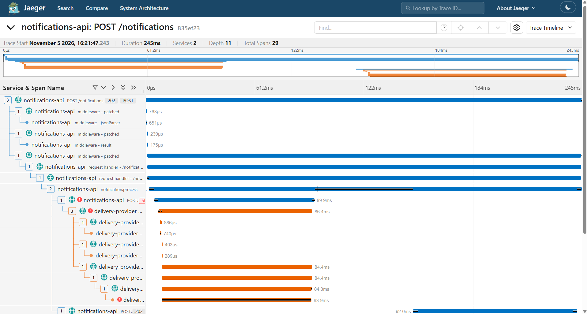
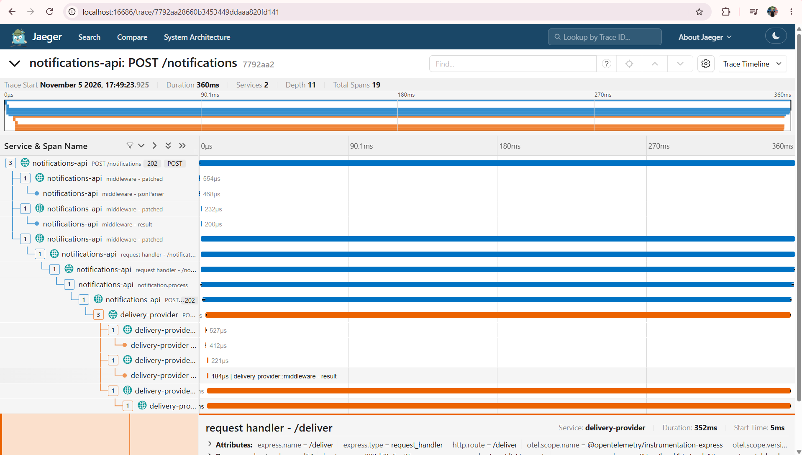
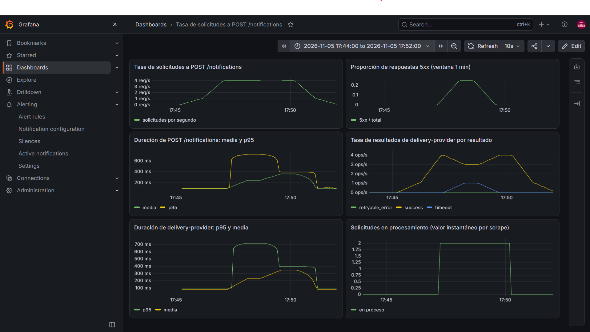

# Laboratorio 4. Trazas distribuidas y correlación de señales

**Integrantes:** Camila Melara, Melisa Torres  
**Repositorio:** https://github.com/CamilaMelara/lab3-Melara-Torres (rama `lab4-tracing`)  
**Commit de Lab 3:** `0b5bc5f14f03c44a7bb9ce3d427f6d8a72b92c0a`  
**Commit de Lab 4:** SHA informado en Moodle (último commit de la rama `lab4-tracing`).

## 1. Línea base del Laboratorio 3

La rama `lab4-tracing` se creó desde el commit entregado en el Laboratorio 3 (`0b5bc5f`), sin cambios locales pendientes.

| Comprobación | Resultado observado | Corrección necesaria, si aplica |
|---|---|---|
| Compilación | `npm run build` terminó sin errores en la rama `lab4-tracing` creada desde `0b5bc5f`. | Ninguna |
| Servicios HTTP | `/health` respondió `{"service":"notifications-api","status":"ok"}` y `{"service":"delivery-provider","status":"ok"}`. `probe:privacy` y `probe:retry` devolvieron HTTP 202. | Ninguna |
| Logs y `request_id` | Los eventos JSON Lines conservan `event` y `request_id`; `req-retry-01` aparece en ambos servicios con la secuencia de reintento; el `grep` de valores sensibles no devolvió coincidencias. | Ninguna |
| Métricas/targets | `/metrics` de ambos servicios contiene las familias del Lab 3 con observaciones (31 líneas `notifications_http_*` y 43 `delivery_request_*`); los targets `notifications-api` y `delivery-provider` están UP en Prometheus. | Ninguna |
| Dashboard anterior | El dashboard `Lab 3 - Notificaciones` sigue mostrando datos con las consultas originales. | Ninguna |

## 2. Infraestructura, autoinstrumentación y propagación

**Archivos modificados y propósito:**

| Archivo | Propósito |
|---|---|
| `otel-collector-config.yaml` (nuevo) | Pipeline de trazas del Collector: recibe OTLP (gRPC 4317 / HTTP 4318), agrupa con `batch` y exporta a Jaeger (`otlp_grpc/jaeger`) y a `debug`. |
| `compose.yaml` | Agrega `jaeger` (UI en 16686) y `otel-collector`; añade `OTEL_SERVICE_NAME`, `OTEL_EXPORTER_OTLP_TRACES_ENDPOINT` y `OTEL_TRACES_SAMPLER=always_on` a ambos servicios y una dependencia de arranque hacia el Collector, conservando las variables y dependencias previas. |
| `instrumentation.cjs` (nuevo) | Bootstrap CommonJS precargado con `--require`: crea e inicia `NodeSDK` con `OTLPTraceExporter` por HTTP y las autoinstrumentaciones (HTTP, Express, Undici/`fetch()`, Pino) antes de cargar la aplicación. Desactiva el envío OTLP de métricas y logs (`OTEL_METRICS_EXPORTER=none`, `OTEL_LOGS_EXPORTER=none`, `disableLogSending: true` en Pino), omite spans de `/health` y `/metrics` y desactiva `fs`, `net` y `dns` por ruido. Cierra el SDK ante `SIGTERM`/`SIGINT`. La propagación usa el propagador W3C `traceparent` por defecto. |
| `services/*/Dockerfile` | Instalación reproducible con `package-lock.json` (`npm ci`), copia de `instrumentation.cjs` y arranque con `--experimental-loader=@opentelemetry/instrumentation/hook.mjs --require ./instrumentation.cjs`. |
| `package.json`, `package-lock.json` | Dependencias de ejecución de OpenTelemetry con versiones exactas. |
| `services/notifications-api/src/notifications.ts` | Span manual `notification.process`, atributos, eventos y estados. Se conservan logs, métricas y respuestas del Lab 3. |
| `services/delivery-provider/src/delivery.ts` | Span manual `delivery.execute`, atributos, eventos y estados. Se conservan logs, métricas y respuestas del Lab 3. |

**Corrección necesaria:** la imagen `otel/opentelemetry-collector:0.163.0` del enunciado no estaba publicada (`docker pull` devolvió `not found` en Docker Hub y ghcr.io). Con autorización de Guillermo se usó `otel/opentelemetry-collector:0.164.0`; el Collector arrancó ("Everything is ready") y recibió spans de ambos servicios (`resource spans: 2`).

No se modificó `logging.ts`: la instrumentación de Pino agrega `trace_id`, `span_id` y `trace_flags` sin cambios en el logger.

**Traza elegida (`trace_id` real):** `ff6dbb51783e01ba1dc689354e6ee657` (escenario `normal`, `request_id` `req-lab4-normal-1793917305-889`).

**Spans de ambos servicios y relación padre-hijo observada:**

Spans observados en Jaeger (se omiten los spans de middleware de Express):

| Servicio | Span | Tipo | `span_id` | Padre | Duración |
|---|---|---|---|---|---:|
| `notifications-api` | `POST /notifications` | SERVER | `0ddbdf985a690826` | ninguno (raíz) | 228.1 ms |
| `notifications-api` | `notification.process` | INTERNAL | `e07a2ee4584062cc` | `request handler - /notifications` (`4c44115dde1ce981`) | 207.5 ms |
| `notifications-api` | `POST` (hacia `/deliver`) | CLIENT | `27f2b13fc868e96f` | `notification.process` (`e07a2ee4584062cc`) | 156.0 ms |
| `delivery-provider` | `POST /deliver` | SERVER | `0913b77cd0bf9e90` | **`POST` CLIENT de `notifications-api` (`27f2b13fc868e96f`)** | 113.1 ms |
| `delivery-provider` | `delivery.execute` | INTERNAL | `27bc9e2fbaab2199` | `request handler - /deliver` (`619987aa51b991c8`) | 84.7 ms |

```text
notifications-api  POST /notifications            SERVER   (raíz)
└─ request handler - /notifications              INTERNAL (Express)
   └─ notification.process                       INTERNAL (manual)
      └─ POST                                    CLIENT   (fetch/Undici)
         └─ delivery-provider  POST /deliver     SERVER   (padre remoto: el CLIENT)
            └─ request handler - /deliver        INTERNAL (Express)
               └─ delivery.execute               INTERNAL (manual)
```

La instrumentación de Express 5 nombra algunos spans de middleware como `middleware - patched`; son spans automáticos y no se usan en el análisis. En el Collector, el exporter `debug` registró `resource spans: 2` (un recurso por servicio) para el lote de las cuatro ejecuciones de prueba.

**Evidencia que demuestra la propagación:** los spans de `notifications-api` y `delivery-provider` comparten el mismo `trace_id`, y el **span padre** del span SERVER `POST /deliver` de `delivery-provider` es el **`span_id` del span CLIENT** de `notifications-api` que hizo la llamada. Esto se comprueba en Jaeger, en el detalle del span SERVER (referencia `CHILD_OF` al span CLIENT). La relación solo puede existir si el encabezado W3C `traceparent` viajó en la solicitud HTTP: dos spans con horas similares, pero en trazas distintas o sin esa referencia, no demostrarían propagación. En la traza `ff6dbb51783e01ba1dc689354e6ee657`, el span SERVER `POST /deliver` de `delivery-provider` (`0913b77cd0bf9e90`) tiene como padre al span CLIENT `27f2b13fc868e96f` de `notifications-api`. La misma relación se observó en las otras tres trazas de prueba (por ejemplo, en `timeout`: SERVER `f07b2119e85e489b` → padre CLIENT `5f9a784173be56d3`).

## 3. Diseño e instrumentación de spans manuales

| Servicio | Pregunta operacional | Span | Inicio/fin | Atributos | Resultados |
|---|---|---|---|---|---|
| `notifications-api` | ¿Qué ocurrió con esta notificación válida, cuántos intentos de entrega necesitó y cuál fue su resultado global? | `notification.process` (INTERNAL) | Inicia **después de validar** la solicitud y termina cuando se conoce el resultado global y se envía la respuesta. Incluye todos los intentos hacia `/deliver` y la espera de 50 ms entre intentos. La validación se excluye porque una solicitud inválida no llega a ser una notificación; su 400 queda en el span HTTP. | `notification.id`, `notification.channel`, `notification.template`, `lab.scenario`, `notification.max_attempts`, `notification.attempts`, `notification.result`, `notification.status_code`, `delivery.last_status_code` | `delivered` (OK), `timeout` (ERROR), `delivery_error` (ERROR), `unexpected_error` (ERROR + excepción registrada) |
| `delivery-provider` | ¿Qué hizo el proveedor con este intento de entrega, cuánto tardó y qué respondió? | `delivery.execute` (INTERNAL) | Inicia **después de validar** la solicitud de entrega y termina cuando el proveedor ya decidió y envió la respuesta (202, 503 o 504). Cubre la espera que determina la duración del intento. | `notification.id`, `notification.channel`, `delivery.attempt`, `lab.scenario`, `delivery.result`, `delivery.status_code` | `success` (OK), `retryable_error` (ERROR del intento), `timeout` (ERROR del intento) |

No se registran `recipient` ni `message` en nombres, atributos ni eventos. `notification.id` sí se incluye como atributo de span: en una traza no genera series temporales, a diferencia de un label de Prometheus.

Las responsabilidades quedan separadas: `notification.process` representa el resultado **global** de la notificación (puede abarcar varios intentos) y `delivery.execute` representa **un intento** en el proveedor. No se creó un span manual por intento en `notifications-api` porque los spans CLIENT automáticos de `fetch()` ya representan cada intento HTTP.

Relaciones observadas en las trazas `normal` (`ff6dbb51783e01ba1dc689354e6ee657`) y `retry-success` (`835ef2370a956f0725db5b582b27e208`):

| Servicio | Span | Tipo | Span padre | Evidencia adicional |
|---|---|---|---|---|
| `notifications-api` | `POST /notifications` | SERVER | ninguno (raíz) | Límite de entrada; duración total vista por el servidor (228.1 ms en `normal`, 244.8 ms en `retry-success`). |
| `notifications-api` | `notification.process` | INTERNAL | `request handler - /notifications` (Express) | `notification.result = delivered`, `notification.attempts` (1 en `normal`, 2 en `retry-success`), `lab.scenario`; en `retry-success`, evento `delivery.attempt.retryable_failure` y estado OK. |
| `notifications-api` | `POST` (a `/deliver`) | CLIENT | `notification.process` | Un span por intento: en `retry-success` hay dos CLIENT hermanos, `95d1253d1b95e993` (ERROR, 89.9 ms) y `ac919a45bbe43619` (sin error, 92.0 ms). |
| `delivery-provider` | `POST /deliver` | SERVER | span CLIENT de `notifications-api` (padre remoto) | En `retry-success`, `0b207a552e861c1c` es hijo de `95d1253d1b95e993` y `976c1de7299c260f` es hijo de `ac919a45bbe43619`: cada intento conserva su propia relación. |
| `delivery-provider` | `delivery.execute` | INTERNAL | `request handler - /deliver` (Express) | `delivery.attempt`, `delivery.result`, `delivery.status_code`; intento 1: `retryable_error`, 503, ERROR, evento `delivery.retryable_error`; intento 2: `success`, 202, OK. |

**Contribución de los spans manuales:** los spans automáticos describen límites de comunicación (entrada HTTP, middleware, salida HTTP) y códigos de estado, pero no dicen qué notificación se procesó, en qué intento, ni cuál fue el resultado de dominio. `notification.process` agrega el resultado global y la cantidad de intentos, y distingue un 503 recuperable (evento, estado OK) de un fallo final (estado ERROR). `delivery.execute` separa el trabajo del proveedor del procesamiento HTTP de Express y etiqueta el resultado de cada intento. Sin ellos, en `retry-success` aparecerían dos llamadas HTTP, una con 503, sin un elemento que declare que la notificación terminó entregada.

**Evento de dominio elegido y justificación:**

- `notification.delivery_timeout` en `notification.process` (atributos `delivery.attempt`, `delivery.status_code`, `delivery.duration_ms`) y `delivery.timeout` en `delivery.execute` (mismos atributos). Representan un hecho puntual con contexto propio: el proveedor no completó la entrega en su tiempo, en un intento concreto, con su duración. El atributo `notification.result` resume el resultado y el estado ERROR indica que la operación falló; el evento registra *cuándo* y *en qué intento* ocurrió el hecho que lo provocó.
- `delivery.attempt.retryable_failure` en `notification.process` (con `delivery.will_retry: true`) y `delivery.retryable_error` en `delivery.execute`. Registran el 503 del primer intento de `retry-success` sin cambiar el estado global de la notificación.

**Tratamiento de errores, excepciones y cierre de spans:**

- Ambos spans se crean con `tracer.startActiveSpan()`, por lo que quedan como contexto activo: los spans CLIENT de `fetch()` y los logs Pino emitidos dentro quedan asociados a ellos.
- `span.end()` está en un bloque `finally`, de modo que el span se cierra en todos los caminos: éxito, retornos anticipados (503, 504) y excepciones.
- **Resultado HTTP de error no es lo mismo que estado del span ni de excepción.** Un 503 o 504 es una respuesta HTTP recibida normalmente; no se lanza ningún `Error` y no se usa `recordException()`. El estado ERROR se asigna cuando la operación representada por el span fracasó: `notification.process` es ERROR solo si la notificación no se entregó; `delivery.execute` es ERROR cuando ese intento respondió 503 o 504. Un 503 recuperable deja `notification.process` en OK si el segundo intento tiene éxito.
- `recordException()` se usa solo en el `catch` de una excepción real (por ejemplo, `fetch()` lanza `TypeError` si el proveedor es inalcanzable), junto con estado ERROR y `notification.result = unexpected_error`. La excepción se vuelve a lanzar para conservar el manejo de errores y la respuesta 502 del Lab 3.

## 4. Correlación con logs Pino

**Implementación adoptada:** vía de referencia. Se usa `@opentelemetry/instrumentation-pino` incluida en `getNodeAutoInstrumentations`, configurada con `disableLogSending: true` (solo correlación, sin envío OTLP de logs). No se modificó `logging.ts` ni se añadió enriquecimiento manual, para no duplicar campos. Los registros emitidos con `req.log` dentro de un span activo incluyen `trace_id`, `span_id` y `trace_flags`, además de `request_id` (pino-http) y los campos de evento del Lab 3 pasado. `service_started` se emite fuera de una solicitud y, correctamente, no lleva `trace_id`.

**`trace_id` utilizado:** `b6354307e497f9291fc7589ad8535446` (escenario `timeout`), copiado de Jaeger.

**Consultas `jq` para ambos servicios:**

```bash
TRACE_ID='b6354307e497f9291fc7589ad8535446'
jq -c --arg id "$TRACE_ID" \
  'select(.trace_id == $id) | {time, service, event, request_id, trace_id, span_id, level}' \
  logs/notifications-api.jsonl
jq -c --arg id "$TRACE_ID" \
  'select(.trace_id == $id) | {time, service, event, request_id, trace_id, span_id, level}' \
  logs/delivery-provider.jsonl
```

**Selección breve de eventos encontrados:**

`notifications-api`:

```json
{"time":1793917306456,"service":"notifications-api","event":"notification.received","request_id":"req-lab4-timeout-1793917306-4331","trace_id":"b6354307e497f9291fc7589ad8535446","span_id":"3ae64c4045fffde9","level":30}
{"time":1793917306456,"service":"notifications-api","event":"delivery.attempt.started","request_id":"req-lab4-timeout-1793917306-4331","trace_id":"b6354307e497f9291fc7589ad8535446","span_id":"3ae64c4045fffde9","level":30}
{"time":1793917307170,"service":"notifications-api","event":"notification.failed","request_id":"req-lab4-timeout-1793917306-4331","trace_id":"b6354307e497f9291fc7589ad8535446","span_id":"3ae64c4045fffde9","level":50}
```

`delivery-provider`:

```json
{"time":1793917306462,"service":"delivery-provider","event":"delivery.received","request_id":"req-lab4-timeout-1793917306-4331","trace_id":"b6354307e497f9291fc7589ad8535446","span_id":"0a1fd1512b8f73df","level":30}
{"time":1793917307164,"service":"delivery-provider","event":"delivery.timeout","request_id":"req-lab4-timeout-1793917306-4331","trace_id":"b6354307e497f9291fc7589ad8535446","span_id":"0a1fd1512b8f73df","level":50}
```

Los cinco eventos comparten `trace_id` y `request_id`. Los de `notifications-api` llevan `span_id` `3ae64c4045fffde9`, que en Jaeger corresponde a `notification.process`; los de `delivery-provider` llevan `0a1fd1512b8f73df`, que corresponde a `delivery.execute`. Cada registro queda asociado al span manual activo en el momento en que se emitió, de modo que desde un log se puede saltar a la operación exacta de la traza y viceversa. La secuencia temporal de los logs es coherente con la traza: `delivery.received` 6 ms después de `delivery.attempt.started`, `delivery.timeout` 702 ms después y `notification.failed` 6 ms más tarde (niveles 30 = INFO, 50 = ERROR).

**Diferencia entre `notification_id`, `request_id`, `trace_id` y `span_id`:**

| Identificador | Qué identifica | Quién lo produce | Uso en esta solución |
|---|---|---|---|
| `notification_id` | La entidad de dominio (la notificación) | El cliente, en el cuerpo | Es para saber qué notificación fue afectada; atributo `notification.id` en spans y campo en logs. Una misma notificación podría aparecer en varias solicitudes. |
| `request_id` | Una solicitud técnica de la aplicación | `X-Request-ID` (o UUID generado por pino-http) | Espara poder correlacionar registros de ambas servicios, también fuera de la instrumentación de trazas; se conserva del Lab 3. |
| `trace_id` | Una ejecución distribuida instrumentada | El SDK de OpenTelemetry al crear el span raíz | Unir todos los spans y registros de la ejecución; se propaga con `traceparent`. Cada nueva ejecución recibe un `trace_id` nuevo aunque se repita un `request_id`. |
| `span_id` | Una operación concreta dentro de la traza | El SDK, uno por span | Indicar dentro de qué operación se emitió un registro; distintos registros de la misma traza pueden tener `span_id` distintos. |

## 5. Análisis breve de los cuatro escenarios

### `normal`

**Recorrido observado y evidencia de contexto:** traza `ff6dbb51783e01ba1dc689354e6ee657`, HTTP 202. 
Duraciones observadas: `POST /notifications` 228.1 ms ⊃ `notification.process` 207.5 ms ⊃ CLIENT 156.0 ms ⊃ SERVER `POST /deliver` 113.1 ms ⊃ `delivery.execute` 84.7 ms. `delivery.execute` coincide con la demora programada (~80 ms), pero las capas externas suman ~143 ms adicionales. Esta fue la primera solicitud tras reiniciar los contenedores; en la ejecución `slow`, hecha un segundo después, la misma diferencia entre capas fue de solo ~19 ms (371.2 − 352.2). Esto es compatible con un costo de la primera solicitud (por ejemplo, establecimiento de conexiones), pero no está demostrado; por eso la comparación de la sección 6 usa trazas tomadas durante el escenario, con el sistema ya en régimen.

El span raíz es el SERVER `POST /notifications` de `notifications-api`. Dentro, `notification.process` contiene un único span CLIENT hacia `/deliver`, cuyo hijo remoto es el SERVER `POST /deliver` de `delivery-provider`, que a su vez contiene `delivery.execute` con `delivery.result = success`. Todos comparten `trace_id`, y el padre del SERVER remoto es el CLIENT de `notifications-api`, lo que confirma la propagación. La estructura permite leer la operación de afuera hacia adentro: entrada del cliente, procesamiento de la notificación, llamada a la dependencia, trabajo del proveedor y resultado (`notification.result = delivered`, HTTP 202).

### `slow`

**Observación preliminar; la tabla de duraciones se presenta en la sección 6:** La traza `c404131e015f4bdbdf48ac34f227e458` (HTTP 202) conserva la misma estructura que `normal`: los mismos cinco spans relevantes y las mismas relaciones padre-hijo, sin errores ni reintentos (`notification.attempts = 1`). Visualmente, casi toda la barra de tiempo corresponde a `delivery.execute` en `delivery-provider` (352.2 ms de los 371.2 ms del span de entrada), y los spans que lo contienen apenas son más largos. Todavía no se atribuye un mecanismo a esa diferencia; la comparación con B se hace en la sección 6.

### `timeout`

**Código HTTP, atributo, evento y estado observados:** [COMPLETAR con la traza real. Esperado:]

Traza `b6354307e497f9291fc7589ad8535446`, respuesta al cliente HTTP 504.

| Elemento | `delivery-provider` | `notifications-api` |
|---|---|---|
| Código HTTP | `POST /deliver` respondió 504 (`delivery.status_code = 504`) | Recibió 504 del proveedor (`delivery.last_status_code = 504`) y respondió 504 al cliente (`notification.status_code = 504`) |
| Atributo | `delivery.result = timeout`, `delivery.attempt = 1` | `notification.result = timeout`, `notification.attempts = 1` |
| Evento | `delivery.timeout` (`delivery.attempt = 1`, `delivery.status_code = 504`, `delivery.duration_ms = 701`) | `notification.delivery_timeout` (`delivery.attempt = 1`, `delivery.status_code = 504`, `delivery.duration_ms = 713`) |
| Estado del span manual | `delivery.execute`: ERROR (703.7 ms) | `notification.process`: ERROR (716.2 ms) |
| Estado de spans HTTP | SERVER `POST /deliver`: ERROR (705.9 ms) | CLIENT `POST`: ERROR (710.2 ms); SERVER `POST /notifications`: ERROR (718.4 ms) |
| Excepción registrada | Ninguna | Ninguna |

Cada elemento aporta algo distinto: el código HTTP es el contrato entre servicios; el atributo resume el resultado de dominio para filtrar trazas; el evento fecha el hecho y su contexto (intento, duración); el estado indica si la operación representada fracasó.

**Diferencia entre resultado HTTP y excepción JavaScript:** el 504 no prueba que se haya lanzado una excepción. En este escenario, `delivery-provider` responde intencionalmente con `res.status(504)` y `fetch()` resuelve la promesa normalmente con ese código; ningún span contiene un evento `exception`. Una excepción real (por ejemplo, proveedor inalcanzable) aparecería con `recordException()` y `notification.result = unexpected_error`. El 504 tampoco permite concluir que hubo congestión de red: la telemetría muestra que casi toda la duración (~700 ms) transcurre dentro de `delivery.execute`, en el proveedor, mientras que la diferencia entre el CLIENT y el SERVER remoto (tiempo de red y serialización) es de pocos milisegundos (CLIENT 710.2 ms − SERVER remoto 705.9 ms = 4.3 ms; SERVER remoto 705.9 ms − `delivery.execute` 703.7 ms = 2.2 ms). Ningún span mide la red por separado, y el diseño del escenario indica que el retraso está programado en el proveedor.

### `retry-success`

**Primer intento, segundo intento y resultado global:** Traza `835ef2370a956f0725db5b582b27e208`, respuesta al cliente HTTP 202.

1. `notification.process` (`4c868b50479dc686`) inicia; primer span CLIENT `95d1253d1b95e993` (89.9 ms, ERROR) → en `delivery-provider`, SERVER `0b207a552e861c1c` (ERROR) y `delivery.execute` `ddd8c2acb90f1a24` con `delivery.attempt = 1`, `delivery.result = retryable_error`, `delivery.status_code = 503`, estado ERROR y evento `delivery.retryable_error`.
2. En `notification.process` se registra el evento `delivery.attempt.retryable_failure` (`delivery.attempt = 1`, `delivery.status_code = 503`, `delivery.will_retry = true`). En logs: `delivery.attempt.retryable_failure` (WARN).
3. Tras la espera, segundo span CLIENT `ac919a45bbe43619` (92.0 ms, sin error) → SERVER `976c1de7299c260f` y `delivery.execute` `864aa29ac2cf4ba8` con `delivery.attempt = 2`, `delivery.result = success`, `delivery.status_code = 202`, estado OK.
4. `notification.process` termina (242.7 ms) con `notification.attempts = 2`, `notification.result = delivered`, `notification.status_code = 202` y estado OK; el SERVER `POST /notifications` responde 202 en 244.8 ms.

El orden se reconstruye por el inicio de los dos spans CLIENT, el atributo `delivery.attempt` de cada `delivery.execute` y los registros `delivery.attempt.started` (`attempt` 1 y 2) que comparten `trace_id`.

**Por qué un intento fallido puede coexistir con una notificación exitosa:** el único componente que conoce el resultado global es `notifications-api`, porque decide si reintenta y qué responde al cliente. `delivery-provider` solo conoce el resultado de cada intento aislado. Por eso el primer `delivery.execute` y su CLIENT quedan en ERROR (ese intento falló) mientras `notification.process` queda en OK: la operación que representa, entregar la notificación, terminó bien. Marcar la notificación como fallida por un error recuperable confundiría un error intermedio con el resultado final.

**Captura:** `evidence/lab4-trace-retry.png`



## 6. Investigación integrada: B frente a D

Experimento: `npm run scenario`, iniciado `2026-11-05T17:44:20-06:00` y terminado `2026-11-05T17:51:14-06:00`. Según los logs, en esta corrida B abarcó 17:46:08–17:47:08 y D 17:48:38–17:50:08. Los logs contienen además una corrida anterior (17:36–17:42) que reutiliza los mismos `request_id`; se distinguió por la hora y por el `trace_id`, que es distinto en cada ejecución.

**Consulta PromQL, magnitud, unidad y ventana:**

```promql
histogram_quantile(0.95, sum by (le) (rate(notifications_http_request_duration_seconds_bucket{route="/notifications"}[1m])))
```

Estimación del percentil 95 de la duración de `POST /notifications` vista por el cliente, en segundos, calculada sobre una ventana de 1 minuto. Se acompaña con la media del mismo panel del dashboard del Lab 3:

```promql
sum(rate(notifications_http_request_duration_seconds_sum{route="/notifications"}[1m])) / sum(rate(notifications_http_request_duration_seconds_count{route="/notifications"}[1m]))
```

**Síntoma en B y D, con valores observados:** valores leídos del dashboard (rango 17:44–17:52, `evidence/lab4-investigation.png`), en la parte estable de cada fase:

| Señal | B, normal (17:46–17:47) | D, slow (17:48:38–17:50:08) |
|---|---:|---:|
| Tasa de solicitudes | ~4 req/s | ~4 req/s |
| Proporción de 5xx | 0 | 0 |
| Duración media `POST /notifications` | ~90 ms | ~360 ms |
| p95 `POST /notifications` | ~90–100 ms | ~390 ms |
| p95 `delivery-provider` | ~90 ms | ~395 ms |

La duración aumenta unas 4 veces entre B y D sin cambio en la tasa ni en los errores. Como la tasa programada es igual, el aumento no se explica por más carga. La media y el p95 suben juntos, lo que indica que la lentitud afecta a casi todas las solicitudes de D y no a una fracción (a diferencia de C, donde el p95 sube mucho más que la media).

**Limitaciones de la métrica y de sus buckets:** el p95 se estima con `histogram_quantile`, que interpola dentro del bucket donde cae el cuantil. Con los buckets del Lab 3 (`… 0.3, 0.4 …`), un p95 en D solo puede ubicarse entre 0.3 y 0.4 s; el valor intermedio es una interpolación, no una medición. La ventana de 1 min mezcla muestras de fases contiguas durante cerca de un minuto tras cada cambio, y Prometheus solo observa en cada scrape. La métrica es agregada: no identifica qué solicitud determinó el p95.

Esto se observa directamente en el experimento: las trazas de D miden ~352–360 ms, pero el dashboard muestra un p95 de ~390 ms. Todas las observaciones de D caen en el bucket (0.3, 0.4] s, y `histogram_quantile` interpola linealmente dentro de él (0.3 + 0.95 × 0.1 ≈ 0.395 s), sin conocer cómo se distribuyen los valores dentro del intervalo. Lo mismo ocurre en B con el bucket (0.05, 0.1] s. El p95 indica en qué intervalo está la duración, no su valor exacto; para mayor precisión se necesitarían buckets más finos alrededor de 0.35 s.

**Traza normal de B (`trace_id`):** `60fefe9c07fbdaae87a28fc1ed9574db` (`request_id` `req-b-0120`, 17:46:38).

**Traza lenta de D (`trace_id`):** `7792aa28660b3453449ddaaa820fd141` (`request_id` `req-d-0180`, 17:49:23).

**Criterio de selección de las trazas:** se eligió una solicitud de la mitad de cada fase (la 120 de 240 en B y la 180 de 360 en D) para evitar los bordes, donde la ventana de 1 min mezcla fases. El `trace_id` se obtuvo del log `notification.received` de cada `request_id`; como esos `request_id` aparecen también en la corrida anterior, se tomó la ocurrencia cuya hora cae dentro del experimento documentado. La pertenencia se confirmó en Jaeger con el atributo `lab.scenario` del span `notification.process` (`normal` en B, `slow` en D) y con `notification.id` (`not-b-0120`, `not-d-0180`). Son ejecuciones concretas de cada condición; no se afirma que sean las muestras que determinan el p95 agregado.

| Operación comparable | B, normal (ms) | D, slow (ms) | Diferencia (ms) |
|---|---:|---:|---:|
| Entrada HTTP a `notifications-api` (SERVER `POST /notifications`) | 88.9 | 360.5 | 271.6 |
| Span manual de `notifications-api` (`notification.process`) | 87.3 | 358.8 | 271.5 |
| CLIENT `/deliver` | 84.7 | 356.1 | 271.4 |
| SERVER `delivery-provider` (`POST /deliver`) | 82.7 | 353.5 | 270.8 |
| Span manual de `delivery-provider` (`delivery.execute`) | 81.7 | 352.1 | 270.4 |

La diferencia de ~271 ms aparece casi igual en los cinco niveles, y el span más interno que la contiene es `delivery.execute` (270.4 ms). El tiempo propio de cada capa, calculado como la diferencia entre un span y el siguiente nivel, casi no cambia entre B y D:

| Tramo (padre − hijo) | B (ms) | D (ms) |
|---|---:|---:|
| SERVER `POST /notifications` − `notification.process` | 1.6 | 1.7 |
| `notification.process` − CLIENT | 2.6 | 2.7 |
| CLIENT − SERVER `POST /deliver` (red, serialización, cola HTTP) | 2.0 | 2.6 |
| SERVER `POST /deliver` − `delivery.execute` | 1.0 | 1.4 |

Por lo tanto, la diferencia se concentra dentro de `delivery.execute`, en `delivery-provider`. Las trazas equivalentes de la corrida anterior (`82227e9b74e9e2d0ef1e1033b410a45f` en B y `cd8a8fef56b3f7a46b01e7e0b9802d08` en D) dieron valores casi idénticos: `delivery.execute` 82.5 ms en B y 352.7 ms en D.

**Por qué no se suman duraciones de spans anidados:** los cinco spans están anidados: cada uno contiene al siguiente. La duración de un span padre ya incluye el intervalo de sus hijos, así que sumarlos contaría varias veces el mismo tiempo (en D, ~5 × 270 ms en lugar de ~270 ms). Lo comparable es la diferencia en cada nivel y la diferencia entre niveles contiguos (tiempo propio de cada capa). Además, la duración de un span es **tiempo transcurrido** (reloj de pared), no tiempo de CPU: un span puede durar 350 ms mientras el proceso solo espera. Los spans por sí solos no permiten inferir uso continuo de CPU, congestión de red ni saturación de recursos.

**Consultas y eventos de logs relacionados con D:**

```bash
TRACE_ID='7792aa28660b3453449ddaaa820fd141'
jq -c --arg id "$TRACE_ID" \
  'select(.trace_id == $id) | {time, service, event, request_id, span_id, duration_ms, dependency_duration_ms, level}' \
  logs/notifications-api.jsonl
jq -c --arg id "$TRACE_ID" \
  'select(.trace_id == $id) | {time, service, event, request_id, span_id, duration_ms, level}' \
  logs/delivery-provider.jsonl
```

```json
{"time":1793922563926,"service":"notifications-api","event":"notification.received","request_id":"req-d-0180","span_id":"98d4e912b593cb42","level":30}
{"time":1793922563926,"service":"notifications-api","event":"delivery.attempt.started","request_id":"req-d-0180","span_id":"98d4e912b593cb42","level":30}
{"time":1793922564284,"service":"notifications-api","event":"notification.delivered","request_id":"req-d-0180","span_id":"98d4e912b593cb42","duration_ms":358,"dependency_duration_ms":357,"level":30}
{"time":1793922563930,"service":"delivery-provider","event":"delivery.received","request_id":"req-d-0180","span_id":"02182f4021204d4a","level":30}
{"time":1793922564281,"service":"delivery-provider","event":"delivery.succeeded","request_id":"req-d-0180","span_id":"02182f4021204d4a","duration_ms":351,"level":30}
```

Los eventos de `notifications-api` llevan el `span_id` de `notification.process` (`98d4e912b593cb42`) y los de `delivery-provider` el de `delivery.execute` (`02182f4021204d4a`). Los logs aportan lo que la traza no tiene: el nombre de evento de dominio del Lab 3, el `request_id` con el que se correlacionan los registros sin depender de la instrumentación de trazas, el nivel, y duraciones medidas por la propia aplicación (`duration_ms` 351 en el proveedor; `duration_ms` 358 y `dependency_duration_ms` 357 en `notifications-api`), coherentes con los spans. La traza aporta lo que los logs no reconstruyen con la misma precisión: la jerarquía (qué operación contiene a cuál), el padre remoto entre servicios y la duración de cada nivel en microsegundos. Con los logs solo se puede aproximar restando timestamps con resolución de milisegundos entre eventos sueltos (por ejemplo, 351 ms entre `delivery.received` y `delivery.succeeded`), sin saber qué ocurrió entre ellos.

| Elemento | Análisis |
|---|---|
| Pregunta operacional | ¿Dónde se concentra el aumento de duración de `POST /notifications` en la fase D respecto de B, con la misma tasa de solicitudes? |
| Evidencia agregada | `histogram_quantile(0.95, …notifications_http_request_duration_seconds_bucket…[1m])` y la media `_sum/_count` en s, ventana 1 min. B (17:46–17:47): media ~90 ms, p95 ~90–100 ms. D (17:48:38–17:50:08): media ~360 ms, p95 ~390 ms. Tasa ~4 req/s y 0 % de 5xx en ambas. El p95 del proveedor sube de ~90 a ~395 ms en el mismo intervalo. |
| Evidencia de trazas | B `60fefe9c07fbdaae87a28fc1ed9574db`, D `7792aa28660b3453449ddaaa820fd141`. La diferencia es de ~271 ms en los cinco niveles (270.4 ms en `delivery.execute`); el tiempo propio de cada capa externa es de 1–3 ms en ambas fases. Misma estructura, un solo intento, estado OK. |
| Evidencia de logs | Consulta por `trace_id` en ambos servicios. `delivery.succeeded` con `duration_ms` 351 en D; `notification.delivered` con `duration_ms` 358 y `dependency_duration_ms` 357. Mismo `trace_id` y `request_id` (`req-d-0180`) en ambos servicios; los `span_id` coinciden con `notification.process` y `delivery.execute`. |
| Interpretación | La degradación de duración en D es compatible con un mayor tiempo transcurrido dentro de la operación del proveedor (`delivery.execute`), no con el procesamiento propio de `notifications-api`, el middleware de Express ni el tramo de red entre servicios, que cambian poco. No hubo errores ni reintentos (0 % 5xx, `notification.attempts = 1`). |
| Hipótesis | El tiempo adicional corresponde a una espera dentro del handler del proveedor, no a trabajo de CPU ni a la comunicación entre servicios. |
| Predicción contrastable | Si la hipótesis es correcta: (1) el uso de CPU del proceso `delivery-provider` en D no debería crecer en proporción a la duración; (2) la diferencia CLIENT − SERVER remoto debería seguir siendo de pocos ms en D; (3) la duración de `delivery.execute` debería mantenerse cerca de ~350 ms aunque baje la tasa de solicitudes (por ejemplo, una sola solicitud `slow` aislada). |
| Evidencia adicional requerida | Ejecutar solicitudes `slow` aisladas (1 req/s y 4 req/s) y comparar `delivery.execute`; consultar `rate(delivery_process_cpu_seconds_total[1m])` (métrica por defecto de `collectDefaultMetrics`) en B y D; o agregar un span hijo dentro de `delivery.execute` que delimite la espera para separarla del resto del trabajo. |
| Conclusión delimitada | Por observabilidad se identificó que la diferencia entre B y D (~271 ms) se concentra dentro de `delivery.execute`, en `delivery-provider`, sin errores ni reintentos y con tasa comparable. Que esa diferencia sea una demora programada (`delay(350)` en el escenario `slow`) se sabe por el diseño didáctico del laboratorio, no por la telemetría: los spans muestran *dónde* transcurre el tiempo, pero no *qué* lo consume. No se ha demostrado la ausencia de consumo de CPU ni se ha descartado otra causa dentro del proveedor. |

**Capturas:** `evidence/lab4-trace-slow.png` y `evidence/lab4-investigation.png`





## 7. Comprobaciones y límites

| Comprobación | Resultado |
|---|---|
| Compilación | `npm run build` sin errores; imágenes reconstruidas con `docker compose up --build -d`, con 6 contenedores en ejecución (servicios, Prometheus, Grafana, Jaeger y Collector `0.164.0`). |
| Comportamiento de los escenarios | Solicitudes manuales: `normal` 202, `slow` 202, `timeout` 504, `retry-success` 202 tras un 503 en el primer intento. `probe:retry` y `probe:privacy` devolvieron 202. En `npm run scenario`: A, B, D y E sin fallos (B 240/240 y D 360/360 con 202); C 270 respuestas 202 y 90 respuestas 504, igual que en el Lab 3. |
| Métricas anteriores | `/metrics` de ambos servicios conserva las familias del Lab 3 con observaciones (16 líneas `notifications_http_*` y 28 `delivery_request_*`); targets UP; el dashboard del Lab 3 mostró el experimento sin cambiar sus consultas (`evidence/lab4-investigation.png`). No se exportan métricas por OTLP. |
| Propagación y spans de dominio | En todas las trazas revisadas, ambos servicios comparten `trace_id` y el SERVER `POST /deliver` es hijo del CLIENT de `notifications-api`. `notification.process` y `delivery.execute` aparecen anidados bajo su span HTTP y cerrados en todos los escenarios, con estado OK o ERROR coherente con el resultado. |
| Logs correlacionados | Eventos de ambos servicios recuperados por `trace_id` en `timeout` (`b6354307e497f9291fc7589ad8535446`) y en D (`7792aa28660b3453449ddaaa820fd141`), con `request_id` conservado y `span_id` del span manual activo. `service_started` no lleva `trace_id`, como corresponde. |
| Privacidad en JSONL y trazas | El `grep` de `DO-NOT-LOG@example.test` y `SECRET-LAB3-DO-NOT-PERSIST-9381` no tuvo coincidencias en ninguno de los dos archivos. La traza de `probe:privacy` (`11861e6d09f1e3fcf9e83bc351386742`) se consultó en la API de Jaeger (`/api/traces/<trace_id>`): tiene 19 spans y 0 coincidencias; los atributos y eventos de los spans no incluyen `recipient` ni `message`. |

**Limitaciones que permanecen y evidencia adicional que sería necesaria:**

- Jaeger usa almacenamiento en memoria: reiniciar el contenedor elimina las trazas; las evidencias dependen de las capturas y de los `trace_id` registrados.
- El muestreo `always_on` es adecuado para este experimento controlado, pero no para producción; con muestreo parcial podría no existir la traza de una solicitud concreta.
- Los spans miden tiempo transcurrido; para atribuir la latencia a CPU, red o espera se necesitarían métricas de CPU por proceso, spans más finos o perfiles.
- No hay una relación directa entre el p95 agregado y una traza individual; se necesitarían exemplars (enlace métrica → `trace_id`) para pasar de un punto del histograma a una traza concreta.
- El p95 depende de los buckets del Lab 3: en D sobreestimó la duración (~390 ms frente a ~352–360 ms en las trazas) por la interpolación dentro del bucket (0.3, 0.4] s.
- El script de escenario reutiliza `request_id` entre corridas; con dos ejecuciones en los mismos logs, un `request_id` no identifica por sí solo una ejecución, y se necesitó el `trace_id` o la hora para distinguirlas.
- La instrumentación de Express 5 nombra algunos spans de middleware de forma poco descriptiva (`middleware - patched`); no afecta el análisis, pero agrega ruido visual.